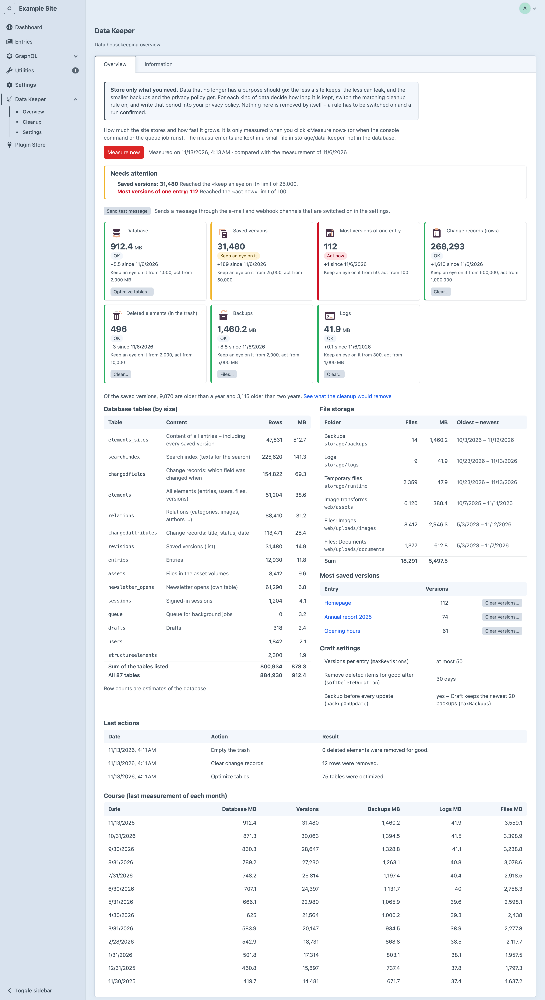
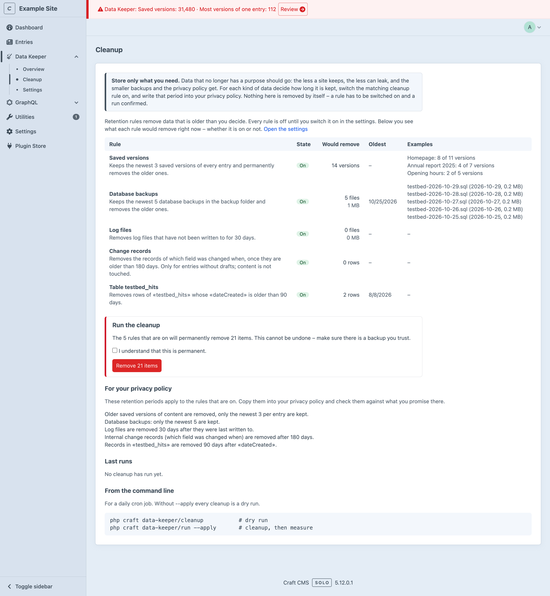
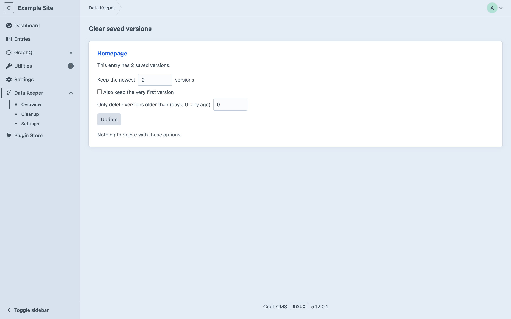
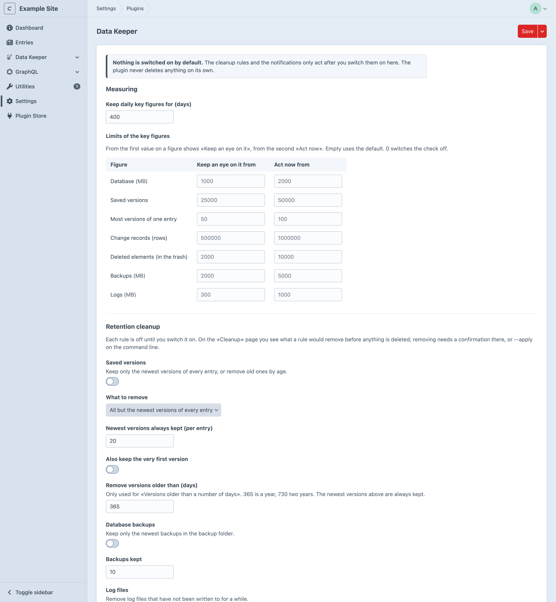

# Data Keeper for Craft CMS

[](https://packagist.org/packages/pixelwerft/data-keeper)
[](https://craftcms.com/)
[](https://php.net/)
[](LICENSE.md)

See how much your site stores and how fast it grows – database, saved versions, change records, deleted elements,
backups, logs and files – and keep that growth in check. Retention rules remove what is too old, **but only after you
switch them on and confirm a run**. Notifications tell you where and when something needs attention.

> Store only what you need. The less a site keeps, the less can leak, the smaller backups get, and the shorter the
> list of retention periods in your privacy policy.

## Screenshots

| | |
| --- | --- |
|  |  |
| Key figures with levels and growth, the database tables, the file storage and the course over the months. | What every rule would remove, before anything is deleted. |
|  |  |
| Clear the saved versions of one entry. | Limits, retention rules and notifications – everything off by default. |

The screenshots show made-up figures from a test install.

## Features

- **Overview** – a card per key figure (database size, saved versions, most versions of one entry, change records,
  deleted elements, backups, logs) with a level (*OK*, *Keep an eye on it*, *Act now*) and the change since the last
  measurement; the largest database tables, the folders (backups, logs, temporary files, image transforms, every local
  asset volume), and the course over the months.
- **Measuring on request** – nothing measures by itself. Measure from the control panel, the console or the queue (for a
  daily cron job). The measurements live in one small JSON file in `storage/data-keeper/`, **not in your
  database** – the tool that watches the database does not grow it, and uninstalling leaves nothing behind.
- **Retention cleanup, opt-in** – rules for saved versions (keep the newest N per entry, or remove everything older than
  1 or 2 years – the newest N and, if you like, the very first version always stay), database backups (keep the
  newest N), log files (older than N days), Craft’s change records (older than N days) and *any other table with a date
  column* (e.g. an access log or a tracking table). Every rule is **off by default**.
- **See before you delete** – the *Cleanup* page shows, for every rule (also the ones that are off), how many items it
  would remove, the oldest one and examples. Removing needs a ticked confirmation, runs in the queue, and is refused if
  the numbers changed since you looked.
- **Clear saved versions per entry** – in *Most saved versions*, clear the versions of one entry: keep the newest N
  (0 clears all), optionally the very first version, and optionally only versions older than N days. Opens in a dialog
  on the overview, shows what goes first, deletes only after you confirm, and can remember your options as the default.
- **Actions on the cards** – clear the change records, empty the trash, clear the log files, list the backup files and
  delete single ones, optimize the database tables and (MySQL, MariaDB) check them for damage. Each opens in a dialog,
  says what it would do, and only runs after you confirm.
- **Sums** – below the database tables (the ones listed and all of them) and below the file storage.
- **Remote queries** – let a tool outside the site read the figures as JSON, for example a dashboard that watches
  several sites. Off by default; access needs the key of the site.
- **Old versions at a glance** – the overview says how many saved versions are older than a year and older than two years.
- **Notifications** – switch on the topics you care about (a figure got too big, no measurement for a while, a cleanup
  finished or failed, old data is waiting). Each is available as a **notice in the control panel**, as a **message
  pushed out** (e-mail, webhook) and at a **status endpoint** a monitoring tool can poll.
- **For your privacy policy** – the page lists the retention periods of all rules that are on, ready to copy.
- Console commands, an optional queue job, a permission. Interface in English, German (`de`, `de-CH`), French and
  Italian.

## Requirements

- Craft CMS 5.0 or later
- PHP 8.2 or later
- MySQL, MariaDB or PostgreSQL (table sizes are read from the database)

## Installation

From the Plugin Store: search for «Data Keeper» and click *Install*.

With Composer:

```bash
cd /path/to/your/project
composer require pixelwerft/data-keeper
php craft plugin/install data-keeper
```

A *Data Keeper* section appears in the control panel. **Nothing is switched on after installing.**

## Permissions

| Permission | What it allows |
| --- | --- |
| *Access Data Keeper* (added by Craft) | Open the section and the overview. |
| *Measure the site* | Use «Measure now». |
| *See what a cleanup would remove, run it and clear saved versions* | Open *Cleanup*, run a cleanup, clear versions of an entry, use the actions on the cards (clear, optimize, check, delete backup files). |

The key for remote queries is shown to admins only, and only admins can replace it.

Settings are for admins (*Settings → Plugins → Data Keeper*, needs `allowAdminChanges`).

## Settings

Everything can also be set in `config/data-keeper.php`, which overrides the settings per environment (the
control panel then shows the field as overridden):

```php
<?php

return [
    // key figures
    'historyDays' => 400,
    'limits' => ['database' => ['warn' => 500, 'alert' => 1500]], // MB; 0 switches a check off
    'tableNotes' => ['myplugin_log' => 'Request log'],

    // retention rules – all off by default
    'revisionsEnabled' => true,
    'revisionsMode' => 'count',    // 'count': all but the newest versions · 'age': versions older than revisionsMaxAgeDays
    'revisionsKeep' => 20,         // newest versions always kept per entry
    'revisionsKeepFirst' => false, // also keep the very first version
    'revisionsMaxAgeDays' => 365,  // for mode 'age': 365 = a year, 730 = two years
    'backupsEnabled' => true,    'backupsKeep' => 10,          // newest database backups
    'logsEnabled' => true,       'logsKeepDays' => 30,         // log files not written to for N days
    'changeRecordsEnabled' => true, 'changeRecordsKeepDays' => 180,
    'customRules' => [
        ['table' => 'myplugin_log', 'column' => 'dateCreated', 'keepDays' => 90, 'enabled' => true],
    ],

    // notifications – all off by default
    'notifyLevels' => true, 'minLevel' => 'warn',              // or 'alert'
    'notifyStale' => true,  'staleAfterDays' => 3,
    'notifyCleanup' => true,
    'notifyBacklog' => true, 'backlogItems' => 1000,
    'remindAfterDays' => 7,                                    // 0: tell only once
    'channelCp' => true,
    'channelEmail' => true,   'emailRecipients' => 'owner@example.com, tech@example.com',
    'channelWebhook' => true, 'webhookUrl' => '$DATA_KEEPER_WEBHOOK_URL', 'webhookSecret' => '$DATA_KEEPER_WEBHOOK_SECRET',
    'statusToken' => '$DATA_KEEPER_STATUS_TOKEN',

    // remote queries – off by default
    'allowRemote' => true,

    // control panel
    'navPosition' => 'secondLast', // where the section sits in the sidebar: 'secondLast', 'last' or 'craft'
    'logsClearable' => true,       // offer «Clear» on the «Logs» card
];
```

Environment variables (`$NAME`) work for the webhook URL, the webhook secret and the status token. **Use them** –
values typed into the settings page are saved in the project config, which usually lives in Git.

### The rules

| Rule | Removes | Notes |
| --- | --- | --- |
| Saved versions | Mode `count`: all but the newest N versions of every entry. Mode `age`: versions saved more than N days ago | In both modes the newest N versions per entry (`revisionsKeep`) and, if `revisionsKeepFirst` is on, the very first version stay. The entry and its current content are never touched. Craft’s own `maxRevisions` only limits new versions; this rule also trims the ones already there. |
| Database backups | All but the newest N files in `storage/backups` | Only `*.sql`, `*.zip`, `*.gz`, `*.dump` directly in that folder. |
| Log files | `*.log` files in `storage/logs` not written to for N days | |
| Change records | Rows of Craft’s `changedfields` and `changedattributes` older than N days, **only for entries without drafts** | They record which field changed when, to merge drafts. Records of entries that have drafts (and of the drafts) are never touched. Craft’s garbage collection removes the same rows, but only now and then. At least 30 days. |
| Other tables | Rows older than N days in a table you name | The table must not be one of Craft’s own, the column must be a date column, at least 7 days. Names are checked against the live schema; nothing else can be typed in. |

### The safety model

1. A rule does nothing until **switched on** in the settings (or the config file).
2. Even then it only removes when a run is **applied**: on the *Cleanup* page by confirming, on the console with
   `--apply`. Without it a console run is a dry run.
3. The *Cleanup* page runs the cleanup **in the queue**, never inside a web request, and the job removes no more per rule than was shown and confirmed – if more has piled up in between, that rule is skipped.
4. Deleted versions, files and rows are gone. Make sure you have a backup you trust before the first run.

## Notifications

A *condition* is something that needs attention right now, for a topic you switched on:

| Topic | Condition |
| --- | --- |
| A key figure is getting too big | A figure reached *Keep an eye on it* (or *Act now*, with `minLevel`). |
| No measurement for a while | The last measurement is older than N days (shown in the control panel and at the endpoint; it cannot be pushed, because nothing runs when measuring stops). |
| A cleanup finished or failed | A failed cleanup is a condition until the next success; a finished one is announced once. |
| A lot of old data is waiting | A rule (on or off) could remove at least N items. |

**Post a message.** The control panel notice is shown to everyone who may open Data Keeper. E-mail and webhook
are *pushed* after every measurement – when a condition is new, when it gets worse, and again after `remindAfterDays`
while it stays, so you do not get the same mail every day. The webhook gets a JSON body (`source`, `site`, `url`,
`sentAt`, `items[]` with `key`, `topic`, `level`, `title`, `message`); with a secret it is signed:

```
X-Data-Keeper-Signature: sha256=<hex HMAC-SHA256 of the raw body>
```

**Status endpoint.** For monitoring tools (Uptime Kuma, Better Stack, a shell script …). It is off until a token is set.

```bash
curl -H "Authorization: Bearer $TOKEN" "https://example.com/actions/data-keeper/status"
curl -i "https://example.com/actions/data-keeper/status?token=$TOKEN&fail=alert"   # tools that can only call a URL
```

```json
{
  "status": "warn",
  "site": "Example",
  "measuredAt": "2026-11-04T13:53:56-08:00",
  "url": "https://example.com/admin/data-keeper",
  "conditions": [
    { "key": "levels:revisions", "topic": "levels", "level": "warn", "title": "Saved versions: 38", "message": "Reached the «keep an eye on it» limit of 10." }
  ]
}
```

`status` is `ok`, `warn` or `alert`. With `?fail=warn` or `?fail=alert` the HTTP status is **503** from that level on, so
a plain «is the URL healthy» monitor raises the alarm. The endpoint only reads what was stored – it never measures – and
answers 404 without a configured token and 401 with a wrong one. A header is safer than `?token=` (URLs end up in logs).

## Actions on the cards

The cards of the overview carry buttons for things you do by hand. Each opens a dialog that says what would happen;
nothing runs before you confirm, and the work is done in the queue.

| Card | Button | What it does |
| --- | --- | --- |
| Database | *Optimize tables* | `OPTIMIZE TABLE` on MySQL and MariaDB (the table is rebuilt, unused space is given back), `VACUUM (ANALYZE)` on PostgreSQL. No data is changed. Worth it after a lot was removed. |
| Database | *Check tables* | `CHECK TABLE` on MySQL and MariaDB: lists what the database reports. Nothing is changed and nothing is repaired – `REPAIR TABLE` does not work with InnoDB, the engine Craft needs; a damaged table is restored from a backup. Not offered on PostgreSQL. |
| Change records | *Clear* | Removes the change records Craft does not need, whatever their age. Records of entries with drafts stay. |
| Deleted elements | *Clear* | Empties the trash with Craft’s own garbage collection, as `craft gc --delete-all-trashed` does. |
| Backups | *Files* | Lists the files in the backup folder; each can be deleted after the browser asked «really?». |
| Logs | *Clear* | Removes all log files directly in the log folder. Can be switched off with `logsClearable`. |

The last results are listed on the overview under *Last actions*.

## Remote queries

A tool outside the site – a dashboard that watches several sites, for example – can read what the overview shows.
Switch on **Allow remote queries** in the settings (`allowRemote`); until then the address answers 404.

Access needs the **key of the site**. It is generated the first time an admin opens the *Information* tab of the
overview, where it can be copied and replaced by a new one. It is kept in the plugin’s file in `storage/`, not in the
project config, so it does not end up in Git, differs per environment and can be replaced on a live site.

```bash
curl -H "Authorization: Bearer $KEY" "https://example.com/actions/data-keeper/remote"
curl "https://example.com/actions/data-keeper/remote?key=$KEY&history=daily"   # tools that can only call a URL
```

The answer holds `schema`, `plugin`, `site`, `url`, `measuredAt`, `comparedWith`, `status` (`ok`, `warn`, `alert`),
`figures` (per key figure: `label`, `value`, `unit`, `level`, `warn`, `alert`, `change`), `tables`, `tablesTotal`,
`folders`, `foldersTotal`, `versionAge`, `config` and `history` (the last measurement of each month, or day by day with
`?history=daily`). It only reads what was stored – it never measures – and answers 401 without the right key. A header
is safer than `?key=` (URLs end up in logs). If `storage/` is not persistent on your host, the key changes with it.

## Console commands

```bash
php craft data-keeper/measure             # measure and store today’s key figures
php craft data-keeper/cleanup/list        # the rules, whether they are on, what each would remove
php craft data-keeper/cleanup             # dry run of the rules that are on
php craft data-keeper/cleanup --apply     # really remove (add --rule=revisions for one rule)
php craft data-keeper/run --apply         # cleanup, then measure – what a daily cron job calls
php craft data-keeper/run --apply --queue # the same, in the queue
php craft data-keeper/status              # what needs attention; exit code 0 ok, 1 warn, 2 alert
php craft data-keeper/maintenance/list    # the actions of the cards and what each would work on
php craft data-keeper/maintenance optimize-tables --apply   # run one (without --apply it only says what it would do)
```

A daily cron job (a measurement a day gives the history and triggers the notifications):

```
15 3 * * * cd /path/to/project && php craft data-keeper/run --apply
```

Use `data-keeper/measure` instead if you only want measurements and no cleanup. For sites without cron, the
queue job `pixelwerft\datakeeper\jobs\RunJob` can be pushed by whatever scheduler you have.

## Good to know

- Measuring counts the files of the backup, log, temporary, transform and local volume folders. On a site with many
  hundred thousand files it takes a while – use the console or the queue for those.
- Row counts of tables are the database’s estimates.
- The measurements are a file in `storage/`. If `storage/` is not persistent on your host (for example containers
  that are rebuilt on every deploy), history and notification state do not survive a rebuild.
- Change records are only used by Craft to merge changes between drafts and the live version. The rule never touches
  content, drafts or versions themselves, nor the records of anything that has drafts.
- Clearing versions needs the *cleanup* permission **and** the right to view and save the entry itself.
- A failed cleanup is logged in full in the Craft log; what is stored, shown and sent out says only that it failed.
- The status endpoint is public: keep the token secret, prefer the header to `?token=` (URLs end up in server logs) and
  rate-limit it at the web server if it is reachable from the internet.
- The queue job and console command use the language of the process; the control panel uses the user’s language.

## Translations

English (source), German (`de`, and `de-CH` for Swiss spelling), French (`fr`) and Italian (`it`). The control panel
shows the language of the signed-in user. To add a language, copy
`src/translations/de/data-keeper.php` to `src/translations/<language>/` and translate the values. You can also
override any string for your site in `translations/<language>/data-keeper.php` in your project.

## Development

```bash
composer install
composer check-cs     # ECS (Craft coding standard)
composer phpstan      # PHPStan with the Craft rules
composer test         # PHPUnit unit tests of the pure logic
```

Craft itself is needed for the rest; the plugin is tested in a throwaway DDEV install with the plugin mounted as a
Composer path repository (`"type": "path", "options": {"symlink": true}`).

## Releases

Versions are cut from git tags (`vX.Y.Z`). The Craft Plugin Store reads the changelog from
[`CHANGELOG.md`](CHANGELOG.md) via the raw URL declared in [`composer.json`](composer.json) → `extra.changelogUrl`.

## License

MIT — see [LICENSE.md](LICENSE.md). The plugin is free.
