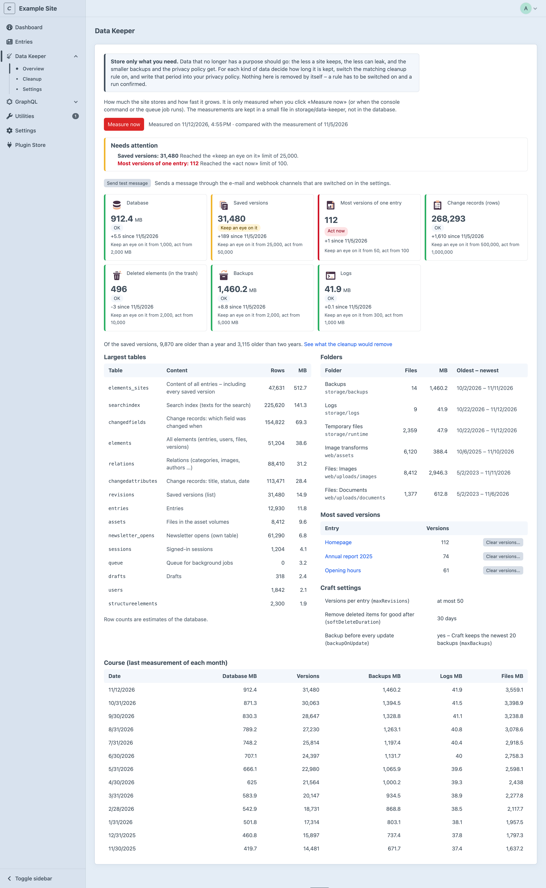
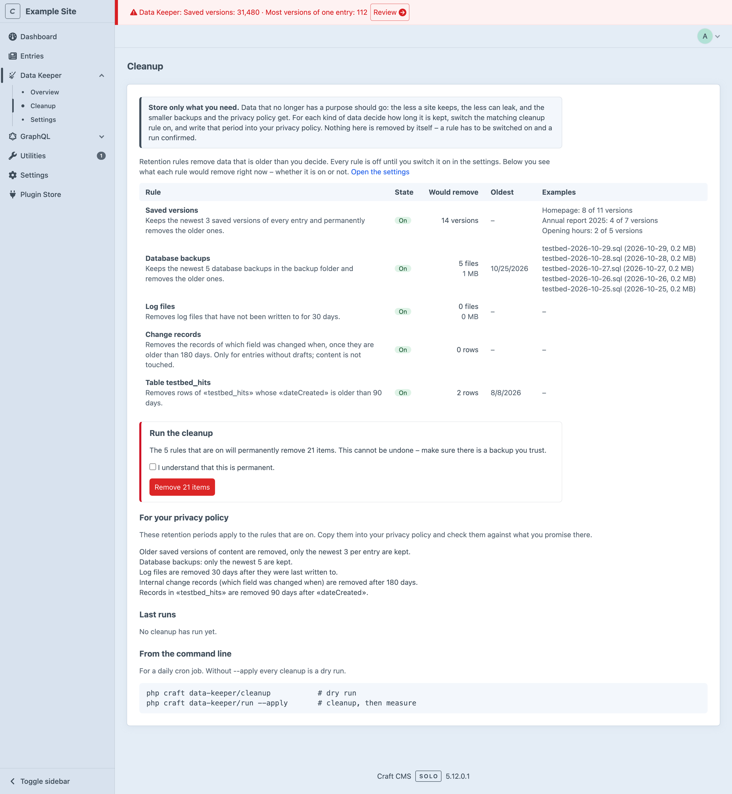
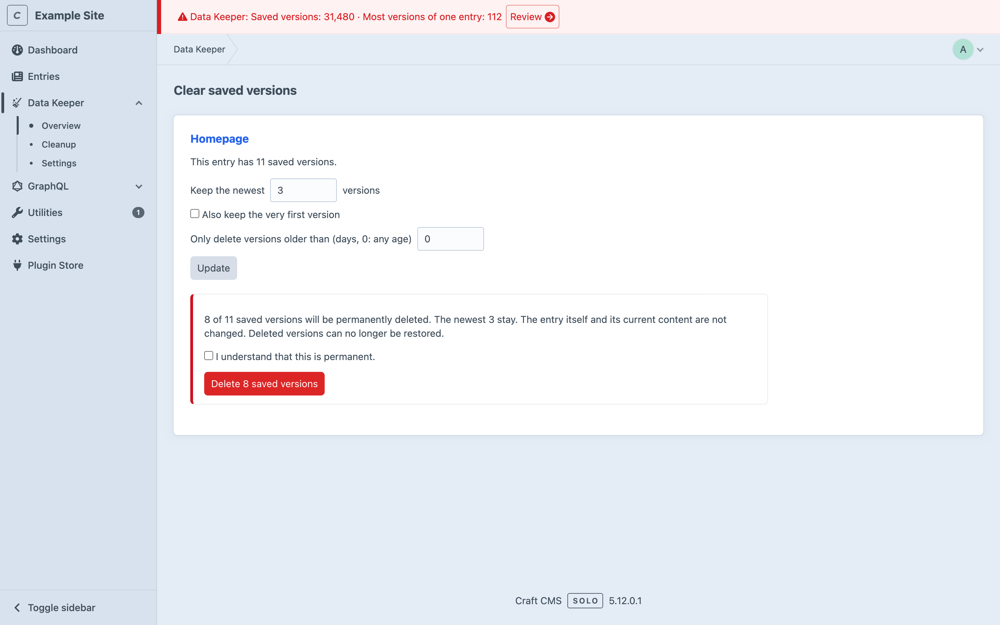
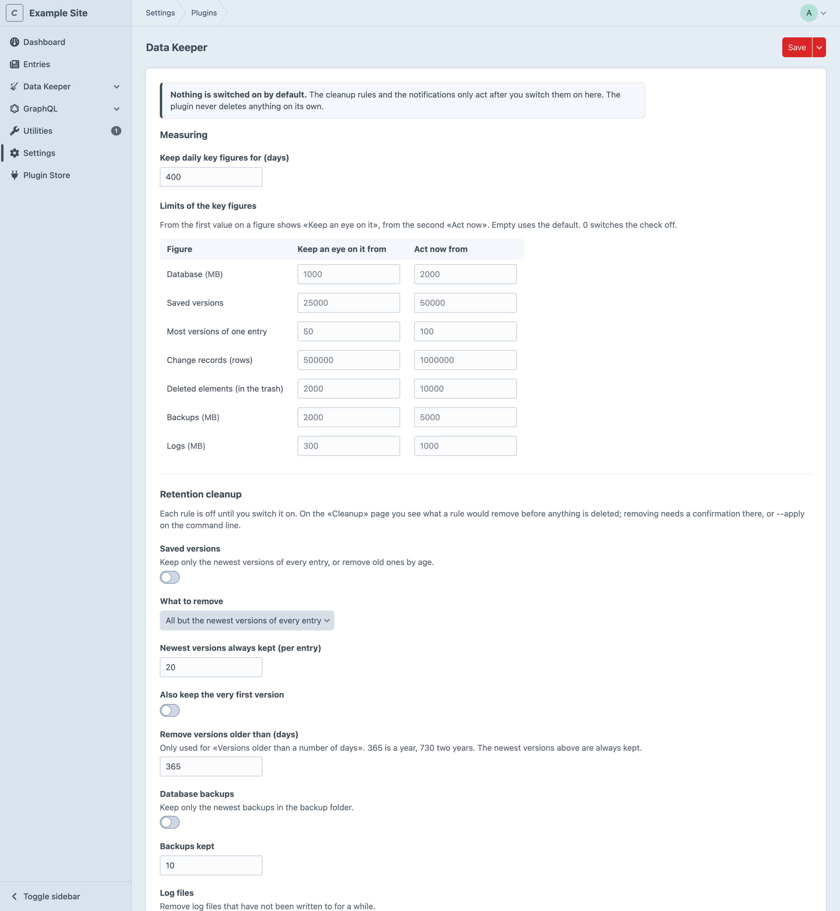

# Data Keeper for Craft CMS

[](https://packagist.org/packages/pixelwerft/data-keeper)
[](https://craftcms.com/)
[](https://php.net/)
[](LICENSE.md)

See how much your site stores and how fast it grows – database, saved versions, change records, deleted elements,
backups, logs and files – and keep that growth in check. Retention rules remove what is too old, **but only after you
switch them on and confirm a run**. Notifications tell you where and when something needs attention.

> Store only what you need. The less a site keeps, the less can leak, the smaller backups get, and the shorter the
> list of retention periods in your privacy policy.

## Screenshots

| | |
| --- | --- |
|  |  |
| Key figures with levels and growth, the database tables, the file storage and the course over the months. | What every rule would remove, before anything is deleted. |
|  |  |
| Clear the saved versions of one entry. | Limits, retention rules and notifications – everything off by default. |

The screenshots show made-up figures from a test install.

## Features

- **Overview** – a card per key figure (database size, saved versions, most versions of one entry, change records,
  deleted elements, backups, logs, cache) with a level (*OK*, *Keep an eye on it*, *Act now*) and the change since the
  last measurement; the database tables, the folders (backups, logs, temporary files, image transforms, every local
  asset volume), and the course over the months.
- **Measuring on request** – nothing measures by itself. Measure from the control panel, the console or the queue (for a
  daily cron job). The measurements live in one small JSON file in `storage/data-keeper/`, **not in your
  database** – the tool that watches the database does not grow it, and uninstalling leaves nothing behind.
- **Retention cleanup, opt-in** – rules for saved versions (keep the newest N per entry, or remove everything older than
  1 or 2 years – the newest N and, if you like, the very first version always stay), database backups (keep the
  newest N), log files (older than N days), Craft’s change records (older than N days) and *any other table with a date
  column* (e.g. an access log or a tracking table). Every rule is **off by default**.
- **See before you delete** – the *Cleanup* page shows, for every rule (also the ones that are off), how many items it
  would remove, the oldest one and examples. Removing needs a ticked confirmation, runs in the queue, and is refused if
  the numbers changed since you looked.
- **Clear saved versions per entry** – in *Most saved versions*, clear the versions of one entry: keep the newest N
  (0 clears all), optionally the very first version, and optionally only versions older than N days. Opens in a dialog
  on the overview, shows what goes first, deletes only after you confirm, and can remember your options as the default.
- **Actions on the cards** – clear the change records, empty the trash, clear the log files (except the ones you
  want kept), compress the database backups, list the backup files and delete single ones, optimize the database
  tables and (MySQL, MariaDB) check them for damage. Each opens in a dialog, says what it would do, and only runs after
  you confirm. While one runs, the overview says so and loads itself again when it is done.
- **Where the data lies** – a card whose figure lies in the database carries the mark **DB** (database, saved
  versions, most versions of one entry, change records, deleted elements). A card without the mark counts files on
  disk (backups, logs, cache).
- **Statistics** – a tab with a chart per key figure: how it developed over 30 days, 90 days, a year or everything
  that is stored, with the limits as lines and a mark on every day something was cleaned up.
- **Sums** – below the database tables (the ones listed and all of them) and below the file storage.
- **Every measurement counts** – measure again after a cleanup: the measurements of the last 31 days are listed one
  by one, also several on one day; the course keeps the last one of each day.
- **Tidy lists** – delete backup files, single measurements and entries of *Last actions* one by one with the trash
  button, or tick several and delete them together. The browser asks before anything goes.
- **Remote monitoring** – let a tool outside the site read the figures, the versions of Craft, PHP, the database and
  the plugins and the available updates as JSON, for example a dashboard that watches several sites. Off by default;
  access needs the key of the site.
- **Old versions at a glance** – the overview says how many saved versions are older than a year and older than two years.
- **Queue watch** – says when Craft’s queue is in trouble: jobs failed, a job hangs, or jobs wait and nothing is being
  worked off. On the overview, as a notification topic, at the status endpoint and in the answer to a remote query.
- **Notifications** – switch on the topics you care about (a figure got too big, no measurement for a while, a cleanup
  finished or failed, old data is waiting, the queue is in trouble). Each is available as a **notice in the control panel**, as a **message
  pushed out** (e-mail, webhook) and at a **status endpoint** a monitoring tool can poll.
- **For your privacy policy** – the page lists the retention periods of all rules that are on, ready to copy.
- Console commands, an optional queue job, a permission. Interface in English, German (`de`, `de-CH`), French and
  Italian.

## Requirements

- Craft CMS 5.0 or later
- PHP 8.2 or later
- MySQL, MariaDB or PostgreSQL (table sizes are read from the database)

## Installation

From the Plugin Store: search for «Data Keeper» and click *Install*.

With Composer:

```bash
cd /path/to/your/project
composer require pixelwerft/data-keeper
php craft plugin/install data-keeper
```

A *Data Keeper* section appears in the control panel. **Nothing is switched on after installing.**

## Permissions

| Permission | What it allows |
| --- | --- |
| *Access Data Keeper* (added by Craft) | Open the section and the overview. |
| *Measure the site* | Use «Measure now». |
| *See what a cleanup would remove, run it and clear saved versions* | Open *Cleanup*, run a cleanup, clear versions of an entry, use the actions on the cards (clear, optimize, check, delete backup files). |

Every page needs *Access Data Keeper*; the other two permissions add to it and open nothing on their own. Admins
have all of them. The key for remote monitoring is shown to admins only, and only admins can allow remote monitoring
or replace the key.

Settings are for admins (*Data Keeper → Settings*, or *Settings → Plugins → Data Keeper*). Saving them needs
`allowAdminChanges`; where that is off – a live server, usually – the page shows them read-only (Craft 5.6 and newer).

## Settings

Everything can also be set in `config/data-keeper.php`, which overrides the settings per environment (the
control panel then shows the field as overridden):

```php
<?php

return [
    // key figures
    'historyDays' => 400,
    'limits' => ['database' => ['warn' => 500, 'alert' => 1500]], // MB; 0 switches a check off
    'tableNotes' => ['myplugin_log' => 'Request log'],

    // retention rules – all off by default
    'revisionsEnabled' => true,
    'revisionsMode' => 'count',    // 'count': all but the newest versions · 'age': versions older than revisionsMaxAgeDays
    'revisionsKeep' => 20,         // newest versions always kept per entry
    'revisionsKeepFirst' => false, // also keep the very first version
    'revisionsMaxAgeDays' => 365,  // for mode 'age': 365 = a year, 730 = two years
    'backupsEnabled' => true,    'backupsKeep' => 10,          // newest database backups
    'logsEnabled' => true,       'logsKeepDays' => 30,         // log files not written to for N days
    'logsKeep' => ['notification-digest.log', 'formie-*.log'], // log files that are never removed (* = any characters)
    'changeRecordsEnabled' => true, 'changeRecordsKeepDays' => 180,
    'customRules' => [
        ['table' => 'myplugin_log', 'column' => 'dateCreated', 'keepDays' => 90, 'enabled' => true],
    ],

    // notifications – all off by default
    'notifyLevels' => true, 'minLevel' => 'warn',              // or 'alert'
    'notifyStale' => true,  'staleAfterDays' => 3,
    'notifyCleanup' => true,
    'notifyBacklog' => true, 'backlogItems' => 1000,
    'notifyQueue' => true,   'queueWaitMinutes' => 15,          // a job waiting longer while none runs: the queue hangs
    'remindAfterDays' => 7,                                    // 0: tell only once
    'channelCp' => true,
    'channelEmail' => true,   'emailRecipients' => 'owner@example.com, tech@example.com',
    'channelWebhook' => true, 'webhookUrl' => '$DATA_KEEPER_WEBHOOK_URL', 'webhookSecret' => '$DATA_KEEPER_WEBHOOK_SECRET',
    'statusToken' => '$DATA_KEEPER_STATUS_TOKEN',

    // remote monitoring – off by default; leave it out to decide with the switch on the «Information» tab
    'allowRemoteMonitor' => true,

    // control panel
    'navPosition' => 'secondLast', // where the section sits in the sidebar: 'secondLast', 'last' or 'craft'
    'logsClearable' => true,       // offer «Clear» on the «Logs» card
];
```

Environment variables (`$NAME`) work for the webhook URL, the webhook secret and the status token. **Use them** –
values typed into the settings page are saved in the project config, which usually lives in Git.

### The rules

| Rule | Removes | Notes |
| --- | --- | --- |
| Saved versions | Mode `count`: all but the newest N versions of every entry. Mode `age`: versions saved more than N days ago | In both modes the newest N versions per entry (`revisionsKeep`) and, if `revisionsKeepFirst` is on, the very first version stay. The entry and its current content are never touched. Craft’s own `maxRevisions` only limits new versions; this rule also trims the ones already there. |
| Database backups | All but the newest N files in `storage/backups` | Only `*.sql`, `*.zip`, `*.gz`, `*.dump` directly in that folder. |
| Log files | `*.log` files in `storage/logs` not written to for N days | |
| Change records | Rows of Craft’s `changedfields` and `changedattributes` older than N days, **only for entries without drafts** | They record which field changed when, to merge drafts. Records of entries that have drafts (and of the drafts) are never touched. Craft’s garbage collection removes the same rows, but only now and then. At least 30 days. |
| Other tables | Rows older than N days in a table you name | The table must not be one of Craft’s own, the column must be a date column, at least 7 days. Names are checked against the live schema; nothing else can be typed in. |

### The safety model

1. A rule does nothing until **switched on** in the settings (or the config file).
2. Even then it only removes when a run is **applied**: on the *Cleanup* page by confirming, on the console with
   `--apply`. Without it a console run is a dry run.
3. The *Cleanup* page runs the cleanup **in the queue**, never inside a web request, and the job removes no more per rule than was shown and confirmed – if more has piled up in between, that rule is skipped.
4. Deleted versions, files and rows are gone. Make sure you have a backup you trust before the first run.

## Notifications

A *condition* is something that needs attention right now, for a topic you switched on:

| Topic | Condition |
| --- | --- |
| A key figure is getting too big | A figure reached *Keep an eye on it* (or *Act now*, with `minLevel`). |
| No measurement for a while | The last measurement is older than N days (shown in the control panel and at the endpoint; it cannot be pushed, because nothing runs when measuring stops). |
| A cleanup finished or failed | A failed cleanup is a condition until the next success; a finished one is announced once. |
| A lot of old data is waiting | A rule (on or off) could remove at least N items. |

**Post a message.** The control panel notice is shown to everyone who may open Data Keeper. E-mail and webhook
are *pushed* after every measurement – when a condition is new, when it gets worse, and again after `remindAfterDays`
while it stays, so you do not get the same mail every day. The webhook gets a JSON body (`source`, `site`, `url`,
`sentAt`, `items[]` with `key`, `topic`, `level`, `title`, `message`); with a secret it is signed:

```
X-Data-Keeper-Signature: sha256=<hex HMAC-SHA256 of the raw body>
```

**Status endpoint.** For monitoring tools (Uptime Kuma, Better Stack, a shell script …). It is off until a token is set.

```bash
curl -H "X-Data-Keeper-Key: $TOKEN" "https://example.com/actions/data-keeper/status"
curl -i "https://example.com/actions/data-keeper/status?statusToken=$TOKEN&fail=alert"   # tools that can only call a URL
```

```json
{
  "status": "warn",
  "site": "Example",
  "measuredAt": "2026-11-04T13:53:56-08:00",
  "url": "https://example.com/admin/data-keeper",
  "conditions": [
    { "key": "levels:revisions", "topic": "levels", "level": "warn", "title": "Saved versions: 38", "message": "Reached the «keep an eye on it» limit of 10." }
  ]
}
```

`status` is `ok`, `warn` or `alert`. With `?fail=warn` or `?fail=alert` the HTTP status is **503** from that level on, so
a plain «is the URL healthy» monitor raises the alarm. The endpoint only reads what was stored – it never measures – and
answers 404 without a configured token and 401 with a wrong one, both as JSON. A header (`X-Data-Keeper-Key` or
`Authorization: Bearer`) is safer than `?statusToken=`, because URLs end up in logs.

## The queue

Craft does its slow work in a queue, and so do the cleanup and the actions of this plugin. When the queue stops,
nothing says so by itself. Data Keeper looks at it whenever it is asked – nothing is stored, nothing is changed – and
reports three kinds of trouble:

- **Failed jobs** stay in the queue until someone runs them again or releases them (level «keep an eye on it»).
- **A job hangs**: it is marked as running but has not reported for longer than it is given to run («act now»).
- **Nothing is being worked off**: a job has been waiting for more than `queueWaitMinutes` (15 by default) and none
  is running – usually `runQueueAutomatically` is off and the cron job or daemon that should run the queue does not
  («act now»).

Where it shows: under *Needs attention* on the overview and as a line on the *Information* tab (always), in the answer
to a remote query (`queue`, always), and – once the topic «The queue is in trouble» (`notifyQueue`) is switched on – in
the control panel notice, the pushed messages and at the status endpoint. A pushed message needs something that still
runs, so let a cron job measure (`craft data-keeper/measure`) rather than rely on the queue for it.

## Statistics

The *Statistics* tab of the overview draws the course of every key figure from the stored measurements – one point
per day, the last measurement of that day. Choose the period: 30 days, 90 days, a year, or everything (as far back as
`historyDays` keeps it, 400 days by default).

- The dashed lines are the limits of the figure («keep an eye on it», «act now»), where they lie in the range shown.
- A mark below the line stands for a day on which a cleanup or an action removed something from that figure; hover
  over it (or read the line below the chart) to see what it was. What was removed shows as a drop.
- Below each chart: the change over the period, in numbers and percent, with the highest and the lowest value.

The charts are drawn by the server as plain SVG – no script, no outside library. A course needs measurements on at
least two days, so let a daily cron job measure (see below).

## Actions on the cards

The cards of the overview carry buttons for things you do by hand. Each opens a dialog that says what would happen;
nothing runs before you confirm, and the work is done in the queue.

While an action waits or runs, a box on top of the overview says so (with the progress, where there is one), the
button on its card reads *Running…*, and the page loads itself again when it is done – with the result on top and the
new numbers on the cards. If the job keeps waiting, the queue of the site is not being run; the box then points to
Craft’s queue manager. A job that failed shows there too.

| Card | Button | What it does |
| --- | --- | --- |
| Database | *Optimize tables* | `OPTIMIZE TABLE` on MySQL and MariaDB (the table is rebuilt, unused space is given back), `VACUUM (ANALYZE)` on PostgreSQL. No data is changed. Worth it after a lot was removed. |
| Database | *Check tables* | `CHECK TABLE` on MySQL and MariaDB: lists what the database reports. Nothing is changed and nothing is repaired – `REPAIR TABLE` does not work with InnoDB, the engine Craft needs; a damaged table is restored from a backup. Not offered on PostgreSQL. |
| Change records | *Clear* | Removes the change records Craft does not need, whatever their age. Records of entries with drafts stay. |
| Deleted elements | *Clear* | Empties the trash with Craft’s own garbage collection, as `craft gc --delete-all-trashed` does. The dialog says what the trash is and what it holds (see below). |
| Backups | *Compress* | Packs every backup that lies in the folder as a plain `.sql` file into a `.sql.zip` next to it and removes the plain file once the zip was checked. The date of the backup stays, and `craft db/restore` takes the zip as it is. Backups that are compressed already are left alone. |
| Backups | *Files* | Lists the files in the backup folder. Delete one with its trash button, or tick several and delete them together; the browser asks «really?» first. |
| Logs | *Clear* | Removes the log files directly in the log folder, except the ones named in `logsKeep`. Can be switched off with `logsClearable`. |
| Cache | *Clear* | Clears Craft’s data cache, the compiled templates and the compiled classes, as Craft’s own *Caches* utility does for these three. Nothing is lost; Craft builds them again. The files of the control panel in the web folder (`cpresources`) are left alone on purpose: if publishing them again is interrupted, editors stay empty. |

The last results are listed on the overview under *Last actions*. Admins can take entries out of that list – one by
one or several ticked ones together; only the entry goes, what the action did stays done.

### The trash

*Deleted elements* counts what lies in Craft’s trash: whatever someone deleted in the control panel is kept for a
while (`softDeleteDuration`, 30 days unless you changed it) so it can be brought back, and removed by Craft’s garbage
collection after that – which only runs now and then, so on a quiet site the trash holds much older things too.

Every element counts on its own: an entry with ten nested entries counts as eleven, and the saved versions and drafts
deleted with it count as well. The dialog lists what the trash holds by kind of element, how many of them are versions
or drafts and nested entries, when the oldest was deleted and how many are older than Craft’s own period.

### Log files to keep

Some logs are records rather than diagnostics – the log of a plugin that notes what it sent, for example. Name them
in the settings under *Log files to keep* (`logsKeep`), one file name per line, `*` for any characters:
`notification-digest.log`, `formie-*.log`. They are never removed, neither by the retention rule for log files nor
by *Clear* on the card, and neither are their rotated copies (`….log.1`). Craft’s own logs (web, console, queue, PHP
errors) only help to look into a problem; nothing else depends on them.

## Remote monitoring

A monitoring tool outside the site – a dashboard that watches several sites, for example – can read what the site
runs on (the versions of Craft, PHP, the database and the plugins, and the updates that are waiting) and what the
overview shows: the key figures and whether one of them is a problem.

It is off until an admin uses **Allow remote monitoring** on the *Information* tab of the overview; until then the
address answers 403 `disabled`. The switch is kept in `storage/`, next to the key: it counts for this environment only
and can be used on a live site, where settings cannot be saved. To fix it per environment instead, set
`allowRemoteMonitor` in `config/data-keeper.php` – the file then decides and the switch on the tab is not offered.

Coming from 1.5 or earlier: the setting was called `allowRemote` and was a plugin setting. Neither is read any more.
After the update remote monitoring is off until an admin allows it on the tab, or until the config file says
`allowRemoteMonitor`.

Access needs the **key of the site**. It is generated the first time an admin opens the *Information* tab of the
overview, where it can be copied and replaced by a new one. It is kept in a file of its own in `storage/` that only
the web server’s user may read – not in the project config, so it does not end up in Git, differs per environment and
can be replaced on a live site.

```bash
curl -H "X-Data-Keeper-Key: $KEY" "https://example.com/actions/data-keeper/remote"
curl -H "Authorization: Bearer $KEY" "https://example.com/actions/data-keeper/remote"   # the same, where it arrives
```

The key goes in a header, never in the address: an address ends up in the logs of web servers and proxies. Queries are
only answered over HTTPS and only to GET.

Use `X-Data-Keeper-Key` if you can. Some web servers – Apache with PHP over CGI or FastCGI, as many shared hosts run
it – do not pass `Authorization` on to PHP. The answer is then 401 with «The key of the site is missing», although
the key was sent.

The answer says what the last measurement found and what the site runs on:

```json
{
  "schema": 2,
  "site": "Example",
  "lastMeasurement": {
    "date": "2026-11-13T05:47:04+01:00",
    "timestamp": 1794545224,
    "sizeUnit": "MB",
    "databaseSize": 683,
    "savedVersions": 11720,
    "mostVersionsOfOneEntry": 36,
    "changeRecords": 280631,
    "deletedElements": 508,
    "backups": { "size": 1460.2, "files": 14 },
    "logs": { "size": 1.5, "files": 9 },
    "cache": { "size": 2, "files": 91 }
  },
  "craftCms": {
    "version": "5.12.0",
    "phpVersion": "8.3.30",
    "databaseVersion": "MariaDB 10.11.19",
    "plugins": [
      { "name": "Data Keeper", "handle": "data-keeper", "version": "1.4.0" }
    ],
    "updatesAvailable": {
      "cms": ["5.12.1"],
      "plugins": { "Data Keeper": ["1.4.1"] }
    }
  },
  "queue": {
    "status": "alert",
    "problems": ["stuck", "failed"],
    "waiting": 4,
    "delayed": 0,
    "running": 0,
    "failed": 1,
    "oldestWaitingMinutes": 95,
    "hungMinutes": null
  }
}
```

- `lastMeasurement` is `null` before the first measurement. It is read as it was stored – nothing is measured. Sizes
  are in MB.
- `queue` is Craft’s queue as it is at the moment of the query (not from the measurement): how many jobs wait, are
  delayed, run and failed, for how many minutes the oldest has been waiting, and `status` (`ok`, `warn`, `alert`) with
  what is wrong in `problems` – `failed` (jobs failed and stay in the queue), `hung` (a job has not reported for
  `hungMinutes`, longer than it is given to run) and `stuck` (a job has been waiting longer than `queueWaitMinutes`
  and none is running: nobody works the queue off). `null` if the site uses another queue than Craft’s own.
- `updatesAvailable` lists the versions Craft and the plugins could be updated to, newest first; `cms` is an empty
  list and `plugins` an empty object when there is nothing to update. It is `null` if Craft could not find out. The
  list comes from Craft, which keeps what it found for a day and asks its update service again after that – such a
  call takes a moment longer.
- The versions of the plugins come without a leading «v» (`1.4.0`, also when the release is tagged `v1.4.0`).
- `lastMeasurement` holds plain values. Whether a value is too high is in the details: `?details=1` adds `details`
  with the overall `status` (`ok`, `warn` or `alert`), the key figures with their level, limits and changes
  (`figures`), `comparedWith`, `tables`, `tablesTotal`, `folders`, `foldersTotal`, `versionAge`, `config`, `recent`
  (every measurement of the last 31 days) and `history` (the last measurement of each month).
- `?details=1&history=daily` gives `history` day by day, as far back as the plugin keeps it (`historyDays`).
  `history=daily` without `details=1` changes nothing.
- `schema` goes up whenever the meaning of a field changes; fields may be added without that.

The answer is always JSON, also when something is wrong:

| HTTP status | `error` | When |
| --- | --- | --- |
| 405 | `method_not_allowed` | The request is not a GET. |
| 403 | `disabled` | Remote monitoring is not allowed on this site (see above). |
| 403 | `https_required` | The request came over plain HTTP. |
| 401 | `unauthorized` | The key is missing or wrong – `message` says which. |

A tool should read `error`, not guess from the HTTP status. (Versions before 1.4 answered with a 404 page while
remote monitoring was off.)

```json
{ "error": "disabled", "message": "Remote queries are not allowed on this site.", "status": 403 }
```

### Keeping it safe

The answer names the versions the site runs on and the updates it is missing, so the key is worth protecting:

- **Treat the key like a password.** Replace it on the *Information* tab if it may have been seen; the old one stops
  working at once. If it could not be stored, the page says so and the old one stays valid.
- **The key does not reach Craft’s log.** Craft writes the request with every warning and error, headers included; the
  plugin takes the key out of the request before that can happen, and never throws on these addresses.
- **Only a clear yes switches it on.** `allowRemoteMonitor` counts as on for `true`, `'1'`, `'true'`, `'on'`, `'yes'` or an
  environment variable with one of these; anything else means off. Without it in the config file, the switch on the
  *Information* tab decides, and that one is off until an admin uses it.
- **Key and switch belong to one environment.** Both are in `storage/`, not in the project config: the key of the
  local copy does not open production, and allowing queries locally does not allow them there.
- **HTTPS.** Behind a proxy that ends HTTPS, Craft has to be told (trusted hosts and headers), or the request looks
  like plain HTTP and is refused. As a last resort `'remoteAllowHttp' => true` in the config file answers over HTTP
  too. While dev mode is on, HTTP is allowed – keep dev mode off in production, as always.
- **Copies of the site.** Leave `storage/data-keeper/` out when you copy production to another environment, or both
  share one key. If `storage/` is not persistent on your host, the key changes with it.

## Console commands

```bash
php craft data-keeper/measure             # measure and store today’s key figures
php craft data-keeper/cleanup/list        # the rules, whether they are on, what each would remove
php craft data-keeper/cleanup             # dry run of the rules that are on
php craft data-keeper/cleanup --apply     # really remove (add --rule=revisions for one rule)
php craft data-keeper/run --apply         # cleanup, then measure – what a daily cron job calls
php craft data-keeper/run --apply --queue # the same, in the queue
php craft data-keeper/status              # what needs attention; exit code 0 ok, 1 warn, 2 alert
php craft data-keeper/maintenance/list    # the actions of the cards and what each would work on
php craft data-keeper/maintenance optimize-tables --apply   # run one (without --apply it only says what it would do)
```

A daily cron job (a measurement a day gives the history and triggers the notifications):

```
15 3 * * * cd /path/to/project && php craft data-keeper/run --apply
```

Use `data-keeper/measure` instead if you only want measurements and no cleanup. For sites without cron, the
queue job `pixelwerft\datakeeper\jobs\RunJob` can be pushed by whatever scheduler you have.

## Good to know

- Measuring counts the files of the backup, log, temporary, transform and local volume folders. On a site with many
  hundred thousand files it takes a while – use the console or the queue for those.
- Row counts of tables are the database’s estimates.
- The measurements are a file in `storage/`. If `storage/` is not persistent on your host (for example containers
  that are rebuilt on every deploy), history and notification state do not survive a rebuild.
- Change records are only used by Craft to merge changes between drafts and the live version. The rule never touches
  content, drafts or versions themselves, nor the records of anything that has drafts.
- Clearing versions needs the *cleanup* permission **and** the right to view and save the entry itself.
- A failed cleanup is logged in full in the Craft log; what is stored, shown and sent out says only that it failed.
- The status endpoint is public: keep the token secret, prefer the header to `?statusToken=` (URLs end up in server logs) and
  rate-limit it at the web server if it is reachable from the internet.
- The queue job and console command use the language of the process; the control panel uses the user’s language.

## Translations

English (source), German (`de`, and `de-CH` for Swiss spelling), French (`fr`) and Italian (`it`). The control panel
shows the language of the signed-in user. To add a language, copy
`src/translations/de/data-keeper.php` to `src/translations/<language>/` and translate the values. You can also
override any string for your site in `translations/<language>/data-keeper.php` in your project.

## Development

```bash
composer install
composer check-cs     # ECS (Craft coding standard)
composer phpstan      # PHPStan with the Craft rules
composer test         # PHPUnit unit tests of the pure logic
```

Craft itself is needed for the rest; the plugin is tested in a throwaway DDEV install with the plugin mounted as a
Composer path repository (`"type": "path", "options": {"symlink": true}`).

## Releases

Versions are cut from git tags (`vX.Y.Z`). The Craft Plugin Store reads the changelog from
[`CHANGELOG.md`](CHANGELOG.md) via the raw URL declared in [`composer.json`](composer.json) → `extra.changelogUrl`.

## License

MIT — see [LICENSE.md](LICENSE.md). The plugin is free.
